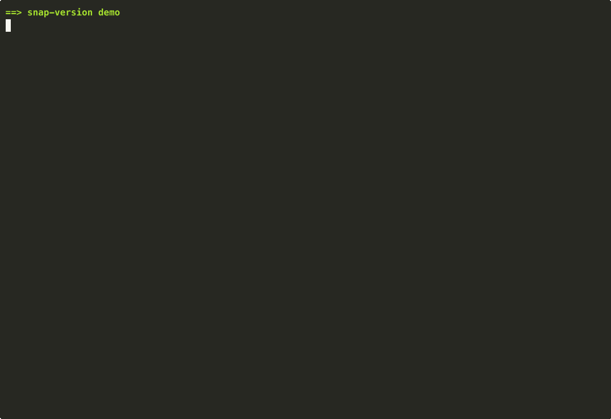

# snap-version

[](https://github.com/AndreKurait/snap-version/actions/workflows/ci.yml)
[](https://github.com/AndreKurait/snap-version/releases)
[](LICENSE)

**Inspect and edit recorded version metadata in OpenSearch and Elasticsearch snapshot repositories.**

`snap-version` is a recovery and format-investigation tool. It reads snapshot
metadata as JSON or Smile with Lucene CodecUtil framing, preserves compression,
and recomputes the CRC32 footer when re-encoding a blob.

Changing a recorded version can bypass a version check. It does **not** convert
Lucene segments, mappings, plugins, or other index data, and it does not establish
that a snapshot can be safely restored on an older cluster.

## Before rewriting

Work on a complete, **offline copy** of the repository and retain an untouched
backup. Stop all writers to the copy; do not edit a repository registered to an
active cluster. Keep the original metadata and shard data together so you can
restore the whole copy after an interrupted operation.

The high-level `version` command validates every selected metadata blob before
writing, checks for stale inventory, writes snapshot blobs first, and writes the
manifest last. Individual local writes use atomic rename. **The whole rewrite is
not a transaction across files or S3 objects.** A write failure or concurrent
writer can still leave a partially changed repository. The tool does not create
automatic backups or perform automatic rollback.

The lower-level `push`, `edit`, and TUI commands write individual blobs directly;
they do not perform the high-level repository preflight.

## Install

These instructions describe version **0.2.0**. Check the selected release's
version and [changelog](CHANGELOG.md) before downloading: older release archives
do not acquire the validation, pagination, or packaging fixes from the current
source tree. Existing installations must be replaced or rebuilt to update.

Build a JVM distribution with Java 21 and the Gradle wrapper:

```sh
git clone https://github.com/AndreKurait/snap-version
cd snap-version
./gradlew installDist
build/install/snap-version/bin/snap-version --help
build/install/snap-version/bin/snap-version --version
```

A Java installation is needed to launch Gradle. The build can provision its
configured Java 21 daemon/toolchain when necessary. Windows users can use
`gradlew.bat` and the generated `.bat` launcher.

The [releases page](https://github.com/AndreKurait/snap-version/releases) also
provides platform-independent JVM distributions (`.tar` and `.zip`) and a fat JAR.
They require Java 21 or later; they are not native executables.

```sh
java -jar snap-version-<version>-all.jar --help
```

## Quick start

Use an existing offline copy, and choose a snapshot name from the inventory:

```sh
# Read-only inventory
snap-version version --repo ./snapshot-copy --show

# Validate the selected rewrite and print changes without writing
snap-version version --repo ./snapshot-copy --to 2.19.0 --snapshot nightly --dry-run

# Apply to the disposable copy after keeping an untouched backup
snap-version version --repo ./snapshot-copy --to 2.19.0 --snapshot nightly --yes
```

Repeat `--snapshot NAME` to select more than one snapshot. Unknown names are an
error; omitting `--snapshot` selects every snapshot. Without `--yes`, the command
asks for confirmation. `--dry-run` requires an explicit `--to` and never writes.

S3 inventory uses the same interface:

```sh
snap-version version --repo s3://my-bucket/snapshot-copy --profile snapshot-readonly --show
```

For an isolated MinIO or other S3-compatible test endpoint, use `--endpoint`,
`--access-key`, `--secret-key`, and `--path-style`. Prefer credential profiles or
the default credential chain for AWS; do not put real secrets in shell history.

## What changes

| Object | Version fields |
| --- | --- |
| `index-N` JSON manifest | Selected snapshots' `version` and `version_id`, when present |
| Root-level `snap-<uuid>.dat` | `snapshot.version_id` inside the framed Smile body |

The rewriter detects OpenSearch's XOR-masked IDs or legacy Elasticsearch's
unmasked release IDs and preserves that flavor. It rejects unreadable, missing,
unsupported, or inconsistent selected metadata before the first write. An
already matching target produces no writes, preserving the original bytes.

Shard data, per-shard snapshot files, index metadata, `index.latest`, and
unselected snapshots are not rewritten. Preserving those objects does not prove
that an older engine understands their contents.

Local repository keys must stay below the repository root. Symlinked keys and
symlinked child directories are rejected. This is not an isolation boundary
against another process replacing directories during an operation; use an offline
copy with no concurrent writers.

## Commands

| Command | Purpose |
| --- | --- |
| `version` | Inventory, validate, preview, and rewrite version metadata |
| `ls` | List snapshots and indices from the manifest |
| `cat` | Decode a metadata blob to JSON |
| `pull` / `push` | Download JSON plus a framing sidecar, or encode and write it back |
| `edit` | Edit a single blob with an external editor |
| `tui` | Browse and edit metadata interactively |
| `decode-file` / `encode-file` | Work on individual local files without S3 |

## Tests and compatibility

```sh
./gradlew test                  # Local unit and CLI tests; no AWS or Docker required
./gradlew e2eTest               # Real OpenSearch + MinIO containers; requires Docker
./gradlew e2eTestElasticsearch   # Separate legacy Elasticsearch container fixture
```

The e2e tasks build their pinned MinIO fixture from source. The first run also
needs internet access for its Go image and dependencies; see
[CONTRIBUTING.md](CONTRIBUTING.md#end-to-end-tests) for details.

Unit tests cover framing and CRC checks, version-ID encoding, local path
containment, paginated S3 listings using a fake client, rewrite preflight,
selection, no-op behavior, dry runs, and simulated write failures. Synthetic
metadata tests are not evidence of engine restore compatibility.

The repository contains container fixtures for:

- OpenSearch **2.19.4 → 2.19.0**, including single and incremental snapshots.
- Elasticsearch **7.17.28 → 7.17.0**, in a separately gated suite.

A passing fixture supports only that version pair, data, and configuration.
It does not establish general support for all OpenSearch 2.x snapshots, other
Elasticsearch generations, cross-major restores, production data, or arbitrary
downgrades. Validate restored document contents, mappings, queries, and other
application requirements on a disposable target cluster before relying on results.

## Contributing and releases

See [CONTRIBUTING.md](CONTRIBUTING.md) for local checks and the release process.
Report a bug with the command, engine versions, and a minimal synthetic
reproduction; remove credentials and private snapshot contents.



The demo illustrates a specific recovery experiment, not a compatibility guarantee.

Licensed under [Apache-2.0](LICENSE).
